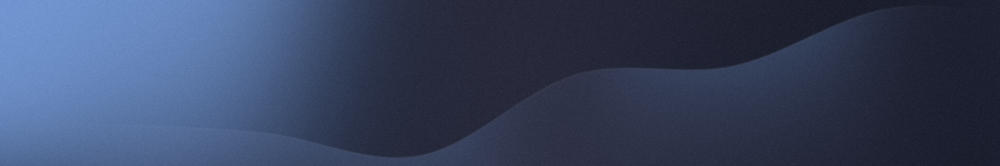
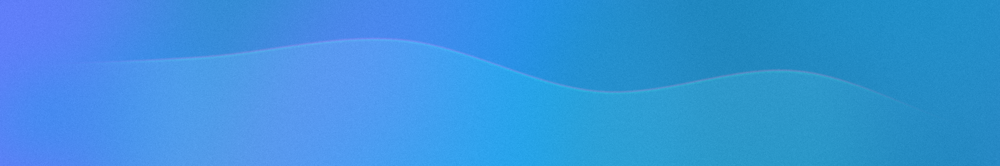
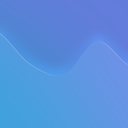
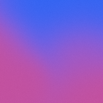
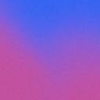
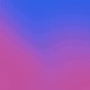

# Gradient Wallpaper

A small tool to quickly generate gradient backgrounds.

## Getting started

The easiest way to use this project is to download the pre-built binary from the
releases. Simply download and [run](#usage).

If you'd rather run the code locally, clone the project and use the following
commands. Python 3.10 or later is required.

```sh
python3 -m venv .venv
source .venv/bin/activate
python -m pip install -e .

gradient-wallpaper create --help
```

This installs the `gradient-wallpaper` command and its NumPy/Pillow dependencies
in an isolated environment.

You can also just run it using Python directly without using any install
scripts.

```sh
python -m gradient_wallpaper create --help
```

## Build a standalone executable

If you want to compile the binary yourself, simply run the `build.py` script.

```sh
python build.py
```

The script creates or reuses `.venv`, installs the build dependencies, and
places the executable in `dist/` (`gradient-wallpaper.exe` on Windows). No
environment activation or separate install/build steps are needed.



## Usage

The simplest way to use the tool is to run it without any arguments. This
randomizes the visual settings and gives you a new image each time.

```sh
gradient-wallpaper create
```

### Commands

The tool has two commands: `create` makes an image, and `eval` shows the
settings saved in a seed.

```sh
gradient-wallpaper create \
  --colors "#173b70" "#7165c8" "#f28a9b" "#ffb36b" \
  --output sunset.png
```

`create` prints a self-contained seed when it finishes; save that seed if you'd
like to make the same image again, modify it with additional settings, or
reverse-engineer it with `eval`.

```sh
gradient-wallpaper eval --seed 'paste-the-seed-printed-by-create'
```

An ordinary text seed can be used as the starting point for randomized settings.
This can be a simple word or phrase.

```sh
gradient-wallpaper create \
  --seed sunset \
  --colors "#173b70" "#7165c8" "#f28a9b" "#ffb36b" \
  --output sunset-from-seed.png
```

The seed which the `create` command returns is a much longer, fully
self-contained seed. It includes all chosen settings and is completely portable.

Whether you use a text seed or a generated, self-contained seed, the output is
fully deterministic based on that seed's value.

### `create` options

Getting started can be intimidating with so many options. Each option is
optional. The best way I've found is to start with just a few options or colors,
then iterate. You can either rerun the same command with modifications, or use
the output seed of the last run as the basis for the next, with your
modifications only overriding specific settings.

#### Output image

| Option           | Example                            | What it does                                                                                                                                             |
| ---------------- | ---------------------------------- | -------------------------------------------------------------------------------------------------------------------------------------------------------- |
| `-h`, `--help`   | `gradient-wallpaper create --help` | Shows the options and their value ranges.                                                                                                                |
| `-o`, `--output` | `--output sunset.png`              | Chooses where the image is saved. Defaults to `wallpaper.png`.                                                                                           |
| `--width`        | `--width 2560`                     | Sets the image width in pixels. Defaults to `1920`.                                                                                                      |
| `--height`       | `--height 1080`                    | Sets the image height in pixels. Defaults to `1080`.                                                                                                     |
| `--format`       | `--format webp`                    | Picks `png`, `jpeg`, or `webp`. If you leave it out but specify an output filename, the file extension decides of your desired output file will be used. |

#### Palette and seed

| Option          | Example                                  | What it does                                                                                                                  |
| --------------- | ---------------------------------------- | ----------------------------------------------------------------------------------------------------------------------------- |
| `--colors`      | `--colors "#173b70" "#f28a9b" "#ffb36b"` | Sets the gradient colors. Add as many stops as you like. If you leave this out, colors are picked from the seed or at random. |
| `--color-order` | `--color-order hue`                      | Keeps your color order with `input`, or sorts the colors by hue with `hue`.                                                   |
| `--seed`        | `--seed sunset`                          | Acts as the basis for all settings. Leave it out for a fully random design.                                                   |

#### Wave

| Option                 | Example                       | What it does                                                                                                                                                             |
| ---------------------- | ----------------------------- | ------------------------------------------------------------------------------------------------------------------------------------------------------------------------ |
| `--wave-amplitude`     | `--wave-amplitude 0.44`       | Controls how far the wave bends from a straight line. Range: `0`-`1`.                                                                                                    |
| `--wave-frequency`     | `--wave-frequency 0.05`       | Controls how much detail the wave has. Range: `0`-`1`.                                                                                                                   |
| `--wave-edge`          | `--wave-edge underglow`       | Use `shadow`, `underglow`, or `aberration` to select what decoration the edge of the wave should have. `auto` picks a treatment from the seed. [See Examples](#examples) |
| `--wave-edge-strength` | `--wave-edge-strength 0.75`   | Turns the wave's edge strength up or down, making it more or less visible. Range: `0`-`1`.                                                                               |
| `--wave-opacity`       | `--wave-opacity 0.9`          | Fades the wave and its lighting. Range: `0`-`1`; use `0` to disable the wave altogether.                                                                                 |
| `--wave-ends`          | `--wave-ends full`            | Chooses `auto`, `fade`, or `full`. Use `fade` for soft ends or `full` to run the wave right to the image edges.                                                          |
| `--wave-orientation`   | `--wave-orientation vertical` | Chooses `auto`, `horizontal`, or `vertical`. `auto` picks an orientation from the seed.                                                                                  |
| `--wave-side`          | `--wave-side start`           | Chooses which side is in the image foreground. Not usually something you need to change. Can be `start` (top/left) or `end` (bottom/right), or `auto`.                   |
| `--wave-rotation`      | `--wave-rotation -8`          | Tilts the wave without changing its orientation. Range: `-15`-`15` degrees.                                                                                              |

#### Framing

| Option       | Example           | What it does                                                                                                                                                                                                                                    |
| ------------ | ----------------- | ----------------------------------------------------------------------------------------------------------------------------------------------------------------------------------------------------------------------------------------------- |
| `--zoom`     | `--zoom 0.25`     | Zooms into the generated image. Maintains the output quality by generating a larger initial image to compensate for the crop. Most useful when paired with the offset settings. Range: `0`-`1` where `0` is no zoom and `1` is a full, 2x zoom. |
| `--offset-x` | `--offset-x 0.5`  | Moves the cropped view left or right within the overscan area. Range: `-1`-`1`; only has an effect when zoom is above `0`.                                                                                                                      |
| `--offset-y` | `--offset-y -0.5` | Moves the cropped view up or down within the overscan area. Range: `-1`-`1`; only has an effect when zoom is above `0`.                                                                                                                         |

#### Gradient and blending

| Option            | Example               | What it does                                                                                |
| ----------------- | --------------------- | ------------------------------------------------------------------------------------------- |
| `--angle`         | `--angle 45`          | Sets the direction of the background point-cloud gradient, in degrees. Range: `-360`-`360`. |
| `--cloud-spread`  | `--cloud-spread 0.5`  | Changes the size and softness of the gradient's color points. Range: `0`-`1`.               |
| `--glue-points`   | `--glue-points 2`     | Adds up to 8 faint, color-blending points. Use `0` to turn this layer off. Range: `0`-`8`.  |
| `--glue-strength` | `--glue-strength 0.3` | Changes how visible the blending layer is. Range: `0`-`1`.                                  |
| `--glue-spread`   | `--glue-spread 0.36`  | Changes the size of the blending points. Range: `0`-`1`.                                    |

#### Finishing touches

| Option                | Example                    | What it does                                                                                       |
| --------------------- | -------------------------- | -------------------------------------------------------------------------------------------------- |
| `--dither-strength`   | `--dither-strength 0.5`    | Adds fine noise to hide banding; more noticeable near `1`. Range: `0`-`1`; use `0` to turn it off. |
| `--halftone-strength` | `--halftone-strength 0.25` | Adds a printed, clustered-dot look. Range: `0`-`1`; use `0` to turn it off.                        |
| `--grain-strength`    | `--grain-strength 0.1`     | Adds fine film grain. Range: `0`-`1`; use `0` to turn it off.                                      |

> [!NOTE]
>
> For all numeric options (besides `--width` and `--height`), you can use
> `random` (or `unset`) instead of a number to pick a fresh value. This changes
> only the selected setting.

### `eval` options

`eval` only needs a seed. It's a quick way to check what rules a seed will
generate.

| Option         | Example                          | What it does                                        |
| -------------- | -------------------------------- | --------------------------------------------------- |
| `-h`, `--help` | `gradient-wallpaper eval --help` | Shows the `eval` usage.                             |
| `--seed`       | `--seed "sunset"`                | Shows the settings that a given seed will generate. |

## Examples

I generated the following to visually demonstrate some of the less obvious
settings. These all have the values cranked (almost) to max to make the effect
of the setting as obvious as possible.

### Wave Edges

The `--wave-edge` settings are some of my favorite. I specifically like the
`aberration` mode.

| Value        | Preview                                          |
| ------------ | ------------------------------------------------ |
| `aberration` |  |
| `shadow`     |          |
| `underglow`  |    |

### Post Effects

The post effect settings are used after creating the base image to add some
visual interest. `--dither` specifically can be pretty subtle, but adding these
can have a huge impact on the feel of the final image.

| Effect       | Preview                                      |
| ------------ | -------------------------------------------- |
| `--dither`   |      |
| `--grain`    |        |
| `--halftone` |  |

> [!NOTE]
>
> Full-sized versions of these examples are available in
> [examples/originals](./examples/originals/).
